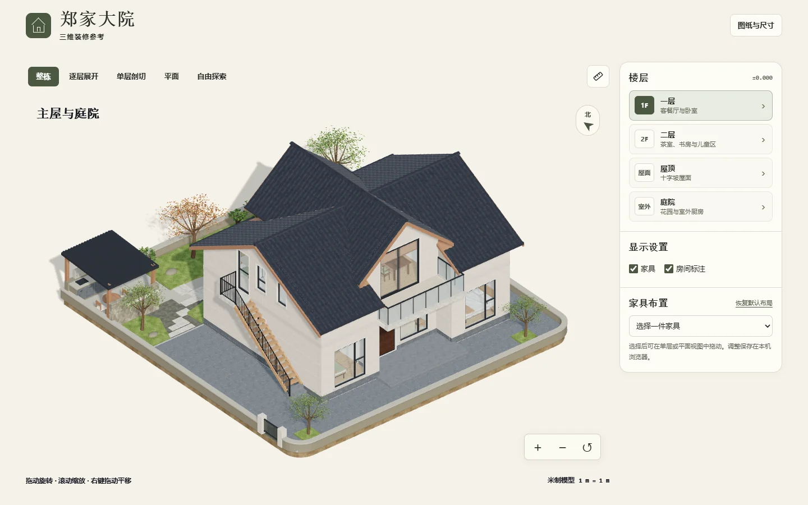
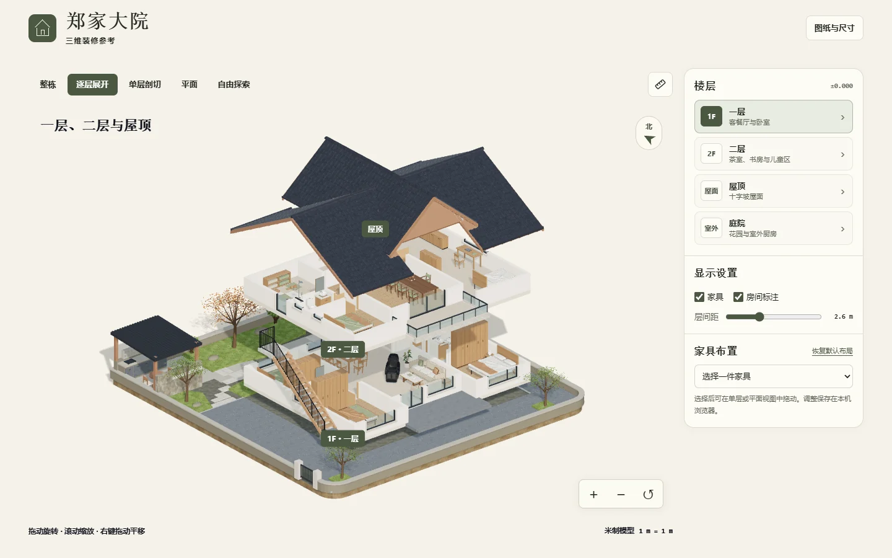
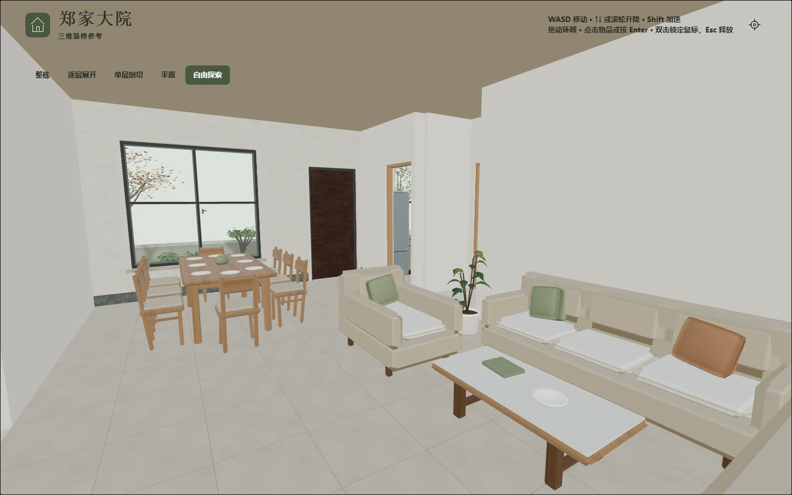

# 郑家大院

樟坑别墅和庭院的米制三维查看器。模型依据建筑平面图、庭院施工图和现场照片搭建，用于查看楼层布局、核对尺寸和试摆家具。 [访问郑家大院](https://zhangkeng.leonz03.dpdns.org/)

## 网页功能

- **楼层与庭院** 支持整栋、逐层展开、单层剖切和平面视图。庭院按施工方案展示。
- **图纸与尺寸** 并排查看一层和二层原设计平面图，在平面视图中测量水平距离。
- **家具布置** 可拖动家具、按 10 厘米微调或旋转 90°。试摆保存在当前浏览器，可恢复默认布局。
- **自由探索** 用第一人称查看室内和庭院，可操作门、台灯和水龙头。手机支持触控游览。

| 逐层展开 | 自由探索 |
| --- | --- |
|  |  |

## 本地运行

- `npm run dev` 启动本地查看器。 [打开本地查看器](http://127.0.0.1:8765/)
- `npm run build:pages` 将发布产物生成到 `dist/`。

## 项目结构

- `site/` 网页、模型和尺寸数据
- `tools/` 本地预览、Blender 模型构建和发布脚本
- `docs/` 建模说明、操作说明和网站截图
- `references/` 本机原始图纸与照片

## 文档

- [写实建模与图纸依据](docs/reconstruction.md)
- [查看器与自由探索操作](docs/reconstruction.md#查看器)
- [Cloudflare Pages 发布与验收](docs/deployment.md)
